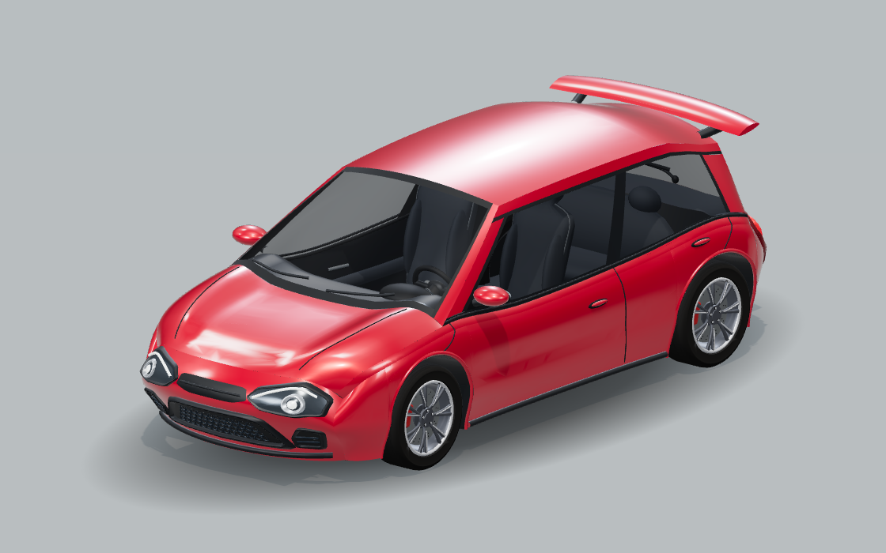
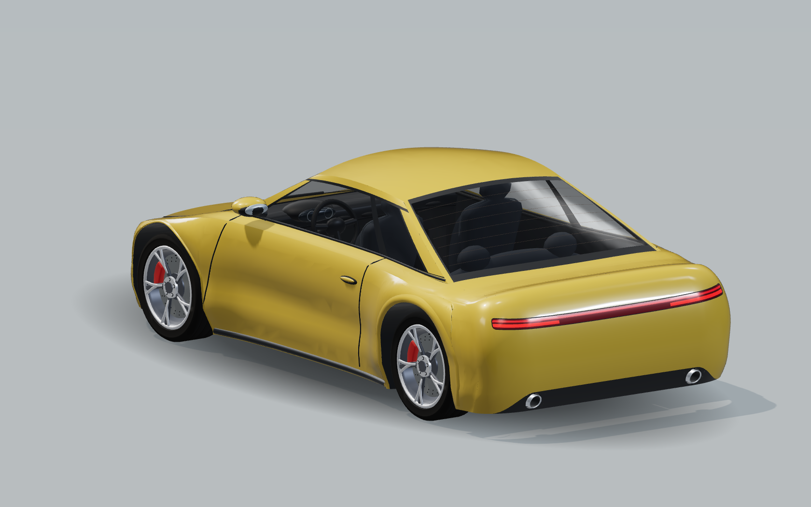

# APEX LINE 车辆模型

游戏从 [素材清单](../public/assets/manifest.json) 读取三个 GLB。下列车模图均由交付的 GLB 渲染，使用驾驶场景的材质替换和车型默认涂装。

| 车型 | 前 3/4 | 后 3/4 | 正侧面 | 正上方 | 正后方 |
| --- | --- | --- | --- | --- | --- |
| 雨燕 GTi · hatch | [](screenshots/car-hatch-front.png) | [](screenshots/car-hatch-rear.png) | [](screenshots/car-hatch-side.png) | [](screenshots/car-hatch-top.png) | [正后方](screenshots/car-hatch-back.png) |
| 朱雀 R · coupe | [](screenshots/car-coupe-front.png) | [](screenshots/car-coupe-rear.png) | [](screenshots/car-coupe-side.png) | [](screenshots/car-coupe-top.png) | [正后方](screenshots/car-coupe-back.png) |
| 雷隼 AWD · rally | [](screenshots/car-rally-front.png) | [](screenshots/car-rally-rear.png) | [](screenshots/car-rally-side.png) | [](screenshots/car-rally-top.png) | [正后方](screenshots/car-rally-back.png) |

## 离地高度对照

[](screenshots/cars-side-heights.png)

三车共用正交相机、比例尺和地面零线，每条水平线相隔 0.1 m。下表高度取自交付的 GLB，单位为米。腰线取侧窗玻璃下沿，引擎盖取前轴正上方的车身中线，保险杠后倾角从竖直方向量起。

| 测量项 | 雨燕 GTi | 雷隼 AWD | 朱雀 R |
| --- | ---: | ---: | ---: |
| 车顶最高点 | 1.44 | 1.47 | 1.30 |
| 腰线 | 0.98 | 1.00 | 0.88 |
| 前轴上方引擎盖 | 0.90 | 0.86 | 0.72 |
| 引擎盖相机离地高度 | 1.121 | 1.134 | 1.032 |
| 引擎盖相机 Z 坐标 | 1.425 | 1.238 | 1.150 |
| 车头最前端上沿 | 0.75 | 0.70 | 0.58 |
| 前保险杠正面中心后倾角 | 7° | 8° | 18° |
| 车顶至腰线的高度 ÷ 腰线高度 | 46.9% | 47.0% | 47.7% |

## 建模方法

车头朝 +Z，左侧为 +X，竖直向上为 +Y，脚本以米为单位。地面原点取前后车轴中点的投影。车轮中心直接取自各车的轮距、轴距和轮胎半径，四个车轮节点分别绕局部 X 轴滚动。

车壳沿车长方向放样。每种车型都有独立的前后悬、挡风玻璃起点和车顶轮廓。引擎盖从风挡底部经前轴到车头用保形三次插值连续下降。横向曲面从中线经过轮拱肩部弯到车侧。轮胎上方留出实际开口，开口内侧接深色轮罩，外侧沿弧线翻边。前保险杠的上沿用水平接缝标出，正面的横截面向两侧包回翼子板。

后窗下沿、后翼子板、行李厢盖与后保险杠沿同一组截面放样。相邻曲面共享边界采样点和法线。保险杠为灯具留出真实开口，密封边略低于外皮，灯罩和发光区沿外皮曲率填入开口。压缩后的三车灯面相对同一横向位置与高度的车身曲面最多凸出 2.8 mm。

后保险杠下缘按每根排气管的位置切出圆孔。孔边向内翻成凹槽，镀铬管口固定在槽底，内壁一直延伸到深色管底。雨燕为单侧双出，朱雀为左右双出，雷隼为单出。压缩后沿五个管口的圆周测量，管唇比同一位置的保险杠表面向后伸出 24.2–25.1 mm。

- 雨燕 GTi 从 B 柱向后的车顶下收 9.0 cm。后窗中心线上沿比下沿靠前 25.4 cm，与竖直方向成 30.0°。C 柱两侧玻璃边缘之间约 9–11 cm。无支架尾翼接着车顶后缘向后伸出 18 cm，两侧尾灯开口各宽 35 cm、高 8 cm。前大灯外框下沿约 0.56 m，高于 0.52 m 的保险杠上沿。
- 雷隼 AWD 的后窗带独立玻璃和加热丝，行李厢盖支撑大尾翼。尾灯两侧各宽 30 cm、高 10 cm，后翼子板平顺接入厢盖。前轴中线处引擎盖离地 0.860 m，前轴前方设进气口。大灯外框下沿约 0.51 m，前保险杠上沿为 0.48 m。
- 朱雀 R 的驾驶舱与车顶后缘相对改前向前移 15 cm。后窗中心线的水平投影长 65.4 cm，后窗下沿到车尾的厢盖长 45.3 cm，末端鸭尾上扬 1.9 cm。前后保险杠底部均高 0.150 m。贯穿尾灯宽 1.70 m，前翼子板保留连续漆面。

三车的胎面、内外胎壁和防擦凸缘共用 `#151515` 的非金属橡胶材质，轮辋单独着色。导出器按材质合并同一刚体上的零件，减面时锁住曲面接缝和车顶、引擎盖、保险杠及前唇的中线测量点。每侧的前后轮共用网格数据，并由各自的节点驱动。

| 交付文件 | 车长 | 轴距 | 轮距 | 轮胎半径 | 整车三角面 | 压缩后大小 |
| --- | ---: | ---: | ---: | ---: | ---: | ---: |
| [hatch.glb](../public/assets/cars/hatch/hatch.glb) | 4.263 m | 2.60 m | 1.54 m | 0.315 m | 72,299 | 343,504 B |
| [rally.glb](../public/assets/cars/rally/rally.glb) | 4.659 m | 2.62 m | 1.56 m | 0.325 m | 72,839 | 350,484 B |
| [coupe.glb](../public/assets/cars/coupe/coupe.glb) | 4.444 m | 2.65 m | 1.58 m | 0.335 m | 73,844 | 342,928 B |

车身零件归在 `body` 下。前风挡、后窗和左右两侧的四块侧窗各自使用独立网格，材质均为 `glass`。游戏通过 `paint` 统一更换车漆，按 `light_head`、`light_tail` 和 `light_brake` 分别设置前灯、尾灯和刹车灯。截图脚本保持车轮着地的静置姿态，用同一套摄影棚灯光渲染四个角度和正后方视图。

## 生成与验收

在仓库根目录执行以下命令。生成器和截图脚本均支持在命令末尾加车型 ID，单独处理一辆车。首次截图前可用 `npx playwright install chromium` 安装浏览器。

```sh
node scripts/models/generate.mjs
npm run assets:check
node scripts/models/capture.mjs
```

生成器先在临时目录写出原始网格，再调用 `scripts/optimize-assets.mjs` 压缩。成功后将打包的 GLB 移入素材目录。压缩保留各车轮的独立节点、朝向、材质和已定型的三角面。引擎盖相机在加载时从风挡最前端向前量 0.20 m，并在此处的实际车漆表面上方取 0.25 m。

在本地运行 `npm run dev` 后，打开 `/?view=drive&track=valley&car=hatch&paint=0`。把 `car` 改为 `coupe` 或 `rally` 可切换车型。涂装编号为 0–3，驾驶时可在浏览器控制台执行 `window.__apex.setPaint(2)` 原地换色。`window.__apex.state().carModel` 显示当前加载的模型来源，正常为 `glb`，文件缺失或无法解析时为 `placeholder`。

## 游戏内高画质截图

| 赛道与视角 | 画面 |
| --- | --- |
| 云杉谷 · 雷隼 AWD 追尾 | [查看截图](screenshots/fix-valley-rally-chase.png) |
| 灯塔海岸 · 朱雀 R 迎着太阳 | [查看截图](screenshots/fix-coast-coupe-chase-toward-sun.png) |
| 灯塔海岸 · 朱雀 R 背对太阳 | [查看截图](screenshots/fix-coast-coupe-chase-away-from-sun.png) |
| 灯塔海岸 · 雨燕 GTi 引擎盖 | [查看截图](screenshots/fix-coast-hatch-hood.png) |
| 灯塔海岸 · 临海弯道和灯塔 | [查看截图](screenshots/fix-coast-sea.png) |
