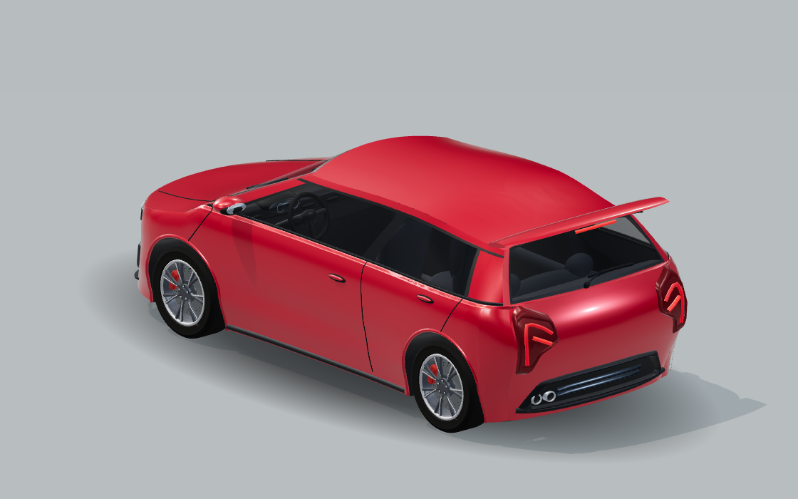
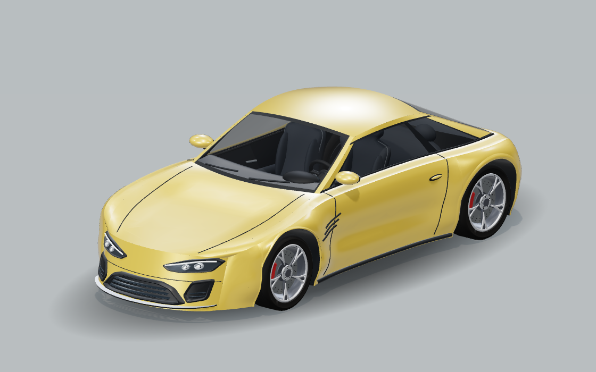
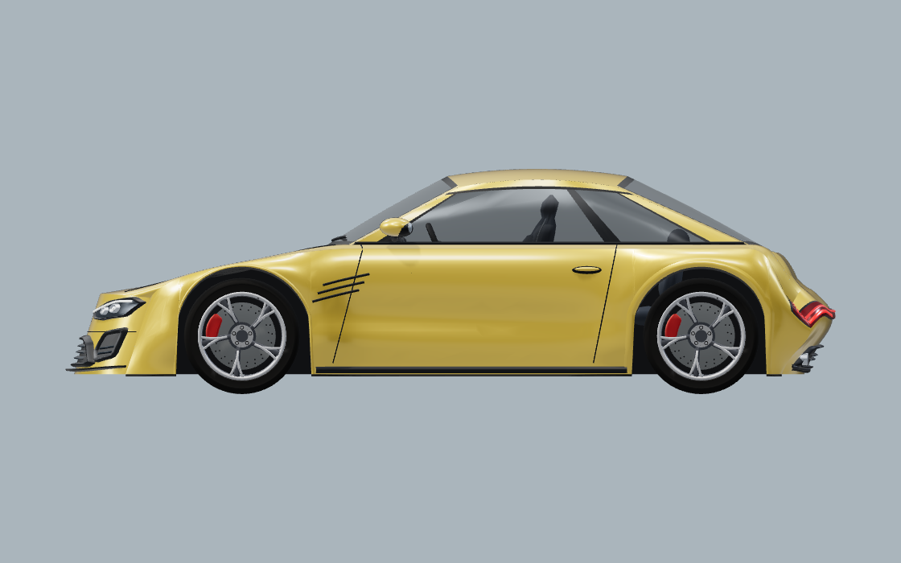
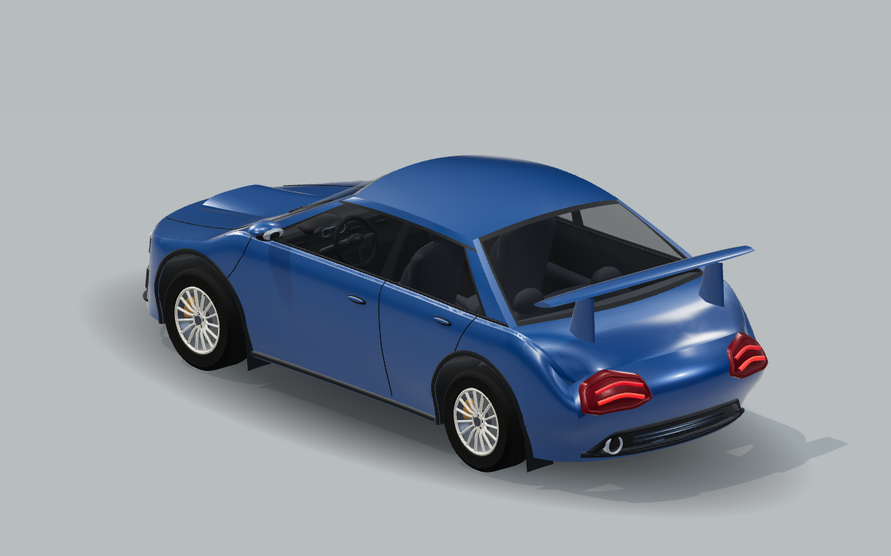
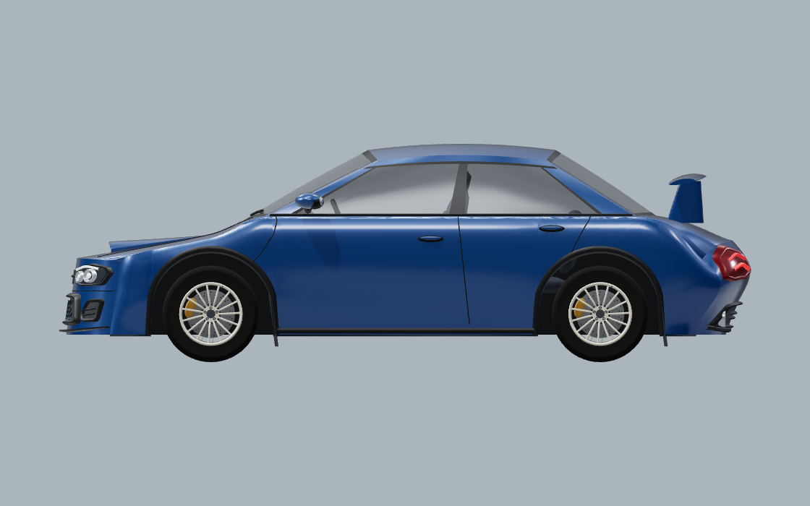
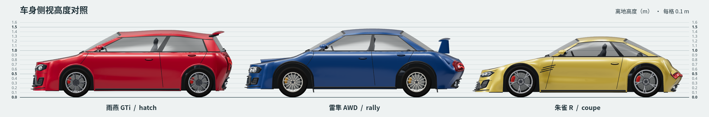

# APEX LINE 车辆模型

游戏从 [素材清单](../public/assets/manifest.json) 读取三个 GLB。下列图片均由交付的 GLB 渲染，使用驾驶场景的材质替换和车型默认涂装。

| 车型 | 前 3/4 | 后 3/4 | 正侧面 | 正上方 |
| --- | --- | --- | --- | --- |
| 雨燕 GTi · hatch | [](screenshots/car-hatch-front.png) | [](screenshots/car-hatch-rear.png) | [](screenshots/car-hatch-side.png) | [](screenshots/car-hatch-top.png) |
| 朱雀 R · coupe | [](screenshots/car-coupe-front.png) | [](screenshots/car-coupe-rear.png) | [](screenshots/car-coupe-side.png) | [](screenshots/car-coupe-top.png) |
| 雷隼 AWD · rally | [](screenshots/car-rally-front.png) | [](screenshots/car-rally-rear.png) | [](screenshots/car-rally-side.png) | [](screenshots/car-rally-top.png) |

## 离地高度对照

[](screenshots/cars-side-heights.png)

三车共用正交相机、比例尺和地面零线，每条水平线相隔 0.1 m。下表高度取自交付的 GLB，单位为米。腰线取侧窗玻璃下沿，引擎盖取前轴正上方的车身中线，保险杠后倾角从竖直方向量起。

| 测量项 | 雨燕 GTi | 雷隼 AWD | 朱雀 R |
| --- | ---: | ---: | ---: |
| 车顶最高点 | 1.44 | 1.47 | 1.30 |
| 腰线 | 0.98 | 1.00 | 0.88 |
| 前轴上方引擎盖 | 0.90 | 0.86 | 0.72 |
| 车头最前端上沿 | 0.75 | 0.70 | 0.58 |
| 前保险杠正面中心后倾角 | 7° | 8° | 18° |
| 车顶至腰线的高度 ÷ 腰线高度 | 46.9% | 47.0% | 47.7% |

## 建模方法

车头朝 +Z，左侧为 +X，竖直向上为 +Y，脚本以米为单位。地面原点取前后车轴中点的投影。车轮中心直接取自各车的轮距、轴距和轮胎半径，四个车轮节点分别绕局部 X 轴滚动。

车壳沿车长方向放样。每种车型都有独立的前后悬、挡风玻璃起点和车顶轮廓。引擎盖从风挡底部经前轴到车头用保形三次插值连续下降。横向曲面从中线经过轮拱肩部弯到车侧。轮胎上方留出实际开口，开口内侧接深色轮罩，外侧沿弧线翻边。前保险杠的上沿用水平接缝标出，正面的横截面向两侧包回翼子板。

- 雨燕 GTi 的车顶从 B 柱向后下收，在尾门上缘降到 1.35 m，比最高点低 9 cm。后窗中心线与竖直方向成 30°。车顶尾翼沿尾门上缘布置，大灯外框下沿约 0.56 m，位于 0.52 m 高的前保险杠上方。
- 雷隼 AWD 的大灯外框下沿约 0.51 m，前保险杠上沿为 0.48 m。前轴前方的进气口从引擎盖表面平顺展开，顶面顺着引擎盖向车头下降。后备厢支撑大尾翼，四个轮拱后方各装一块泥挡。
- 朱雀 R 的驾驶舱相对上一版前移 15 cm，车顶沿纵向加长 10 cm。前翼子板向轮拱外侧隆起，同一纵向位置上最多高出引擎盖中线约 4.5 cm。低短车尾保留约 1.71 m 宽的贯穿尾灯。

三车的胎面、内外胎壁和防擦凸缘共用 `#151515` 的非金属橡胶材质，轮辋单独着色。导出器按材质合并同一刚体上的零件，减面时锁住曲面接缝和车顶、引擎盖、保险杠及前唇的中线测量点。每侧的前后轮共用网格数据，并由各自的节点驱动。

| 交付文件 | 车长 | 轴距 | 轮距 | 轮胎半径 | 整车三角面 |
| --- | ---: | ---: | ---: | ---: | ---: |
| [hatch.glb](../public/assets/cars/hatch/hatch.glb) | 4.263 m | 2.60 m | 1.54 m | 0.315 m | 69,748 |
| [rally.glb](../public/assets/cars/rally/rally.glb) | 4.659 m | 2.62 m | 1.56 m | 0.325 m | 68,738 |
| [coupe.glb](../public/assets/cars/coupe/coupe.glb) | 4.444 m | 2.65 m | 1.58 m | 0.335 m | 68,166 |

车身零件归在 `body` 下，风挡和车窗使用 `glass`。游戏通过 `paint` 统一更换车漆，按 `light_head`、`light_tail` 和 `light_brake` 分别设置前灯、尾灯和刹车灯。截图脚本保持车轮着地的静置姿态，用同一套摄影棚灯光渲染四个角度，便于比较车身比例。

## 生成与验收

在仓库根目录执行以下命令。生成器和截图脚本均支持在命令末尾加车型 ID，单独处理一辆车。首次截图前可用 `npx playwright install chromium` 安装浏览器。

```sh
node scripts/models/generate.mjs
npm run assets:check
node scripts/models/capture.mjs
```

在本地运行 `npm run dev` 后，打开 `/?view=drive&track=valley&car=hatch&paint=0`。把 `car` 改为 `coupe` 或 `rally` 可切换车型。涂装编号为 0–3，驾驶时可在浏览器控制台执行 `window.__apex.setPaint(2)` 原地换色。`window.__apex.state().carModel` 显示当前加载的模型来源，正常为 `glb`，文件缺失或无法解析时为 `placeholder`。
